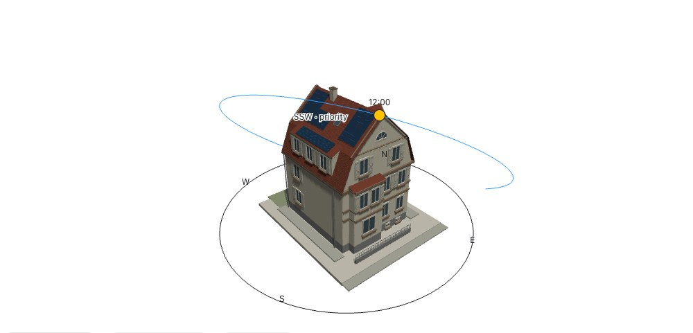
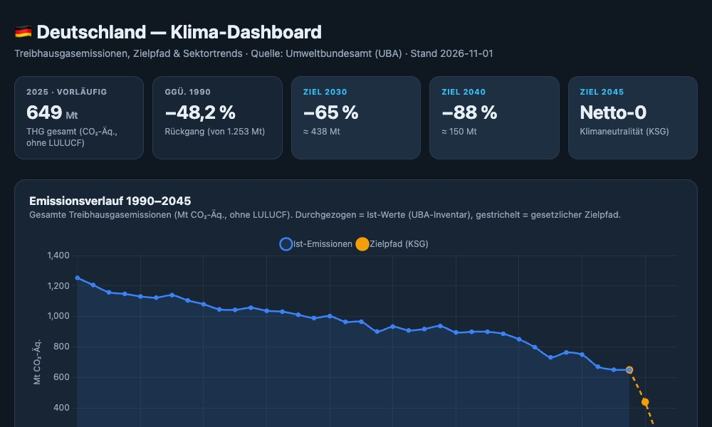

```{=html}
<div class="project-showcase">
<p class="projects-intro">Interaktive Werkzeuge für Klimadaten, Photovoltaik und Batteriespeicher.</p>
<div class="project-grid">
<article class="project-card" aria-labelledby="solar-project-title">
  <a class="project-preview" href="../solar-studie.html" aria-label="Solar- und Speicherrechner öffnen">
    
    <span class="project-preview-label" aria-hidden="true">3D-Modell erkunden <span>↗</span></span>
  </a>
  <div class="project-card-body">
    <span class="project-type">Interaktive Demo</span>
    <h2 id="solar-project-title"><a href="../solar-studie.html">Interaktiver Solar- und Speicherrechner</a></h2>
    <p class="project-description">PV-Module anordnen, Stromerträge abschätzen und Batteriespeicher vergleichen.</p>
    <div class="project-actions">
      <a class="project-button" href="../solar-studie.html">Demo öffnen <span aria-hidden="true">↗</span></a>
      <a class="project-source" href="https://github.com/jinggling09/jinggling09.github.io/blob/main/solar-studie.html">Quellcode ansehen <span aria-hidden="true">↗</span></a>
    </div>
    <ul class="project-features">
      <li>PV-Module auf zwei Dachflächen anordnen</li>
      <li>Tages-, Monats- und Quartalserträge schätzen</li>
      <li>Eigenversorgung mit Batteriespeicher vergleichen</li>
    </ul>
    <p class="project-note">Öffentliche Demo mit fiktivem Standort und Beispielverbräuchen.</p>

    <details class="project-details">
      <summary>Methodik &amp; Modellgrenzen</summary>
      <div class="project-details-content">
        <p>KI-gestütztes Lernprojekt zur energetischen Modernisierung. Die Modulbelegung basiert auf vorläufigen Gebäude- und Dachmaßen; der öffentliche Rechner verwendet einen fiktiven Referenzstandort.</p>
        <p>Gebäudeschatten werden visualisiert, aber nicht automatisch vom berechneten Stromertrag abgezogen. Nachbargebäude, Bäume und Gelände werden im 3D-Modell nicht berücksichtigt. Die vereinfachten Ertrags- und Speicherberechnungen ersetzen keine Fachplanung.</p>
        <p>Rechner auf Deutsch, 3D-Steuerung teilweise auf Englisch. Datenquellen und weitere Annahmen sind in der Demo erläutert.</p>
        <p class="project-meta">Demo-Stand: 02.11.2026</p>
      </div>
    </details>
  </div>
</article>
<article class="project-card" aria-labelledby="dashboard-project-title">
  <a class="project-preview project-preview-dark" href="../wissen/emissionen-de.html" aria-label="Klima-Dashboard Deutschland öffnen">
    
    <span class="project-preview-label" aria-hidden="true">Emissionsdaten erkunden <span>↗</span></span>
  </a>
  <div class="project-card-body">
    <span class="project-type">Datenanalyse</span>
    <h2 id="dashboard-project-title"><a href="../wissen/emissionen-de.html">Klima-Dashboard Deutschland</a></h2>
    <p class="project-description">Treibhausgasemissionen, Sektortrends und Klimaziele in einer interaktiven Übersicht.</p>
    <div class="project-actions">
      <a class="project-button" href="../wissen/emissionen-de.html">Dashboard öffnen <span aria-hidden="true">↗</span></a>
      <a class="project-source" href="https://github.com/jinggling09/germany-climate-dashboard">Quellcode ansehen <span aria-hidden="true">↗</span></a>
    </div>
    <ul class="project-features">
      <li>Gesamtemissionen und Zielpfad gegenüberstellen</li>
      <li>Entwicklungen einzelner Sektoren verfolgen</li>
      <li>Sektoranteile an den Gesamtemissionen vergleichen</li>
    </ul>
    <p class="project-note">Datengrundlage: Treibhausgasinventare des Umweltbundesamts.</p>

    <details class="project-details">
      <summary>Daten &amp; Methodik</summary>
      <div class="project-details-content">
        <p>Interaktive Auswertung der nationalen Treibhausgasinventare. Die Daten werden automatisiert aus dem UBA-DataCube aktualisiert; der Zielpfad orientiert sich am Klimaschutzgesetz.</p>
        <p>Datenstand, Abgrenzungen und Quellen sind im Dashboard angegeben. Die Vorschau zeigt eine Momentaufnahme; aktuelle Werte finden Sie in der Anwendung.</p>
      </div>
    </details>
  </div>
</article>
</div>
<section class="project-in-progress" aria-labelledby="lca-project-title">
  <div>
    <span class="project-type project-type-pending">In Arbeit</span>
    <h2 id="lca-project-title">Produkt-CO₂-Fußabdruck im Vergleich</h2>
    <p>Vergleich zweier Produktvarianten mit openLCA. Geplant sind die Bewertung der Klimawirkung und weiterer Umweltwirkungen.</p>
  </div>
  <div class="project-progress-detail">
    <span class="project-small-heading">Geplante Methoden</span>
    <p>IPCC 2021 GWP100 · ReCiPe 2016</p>
    <p class="project-note">Ergebnisse und eine Projektansicht folgen nach Abschluss.</p>
  </div>
</section>
</div>
```
